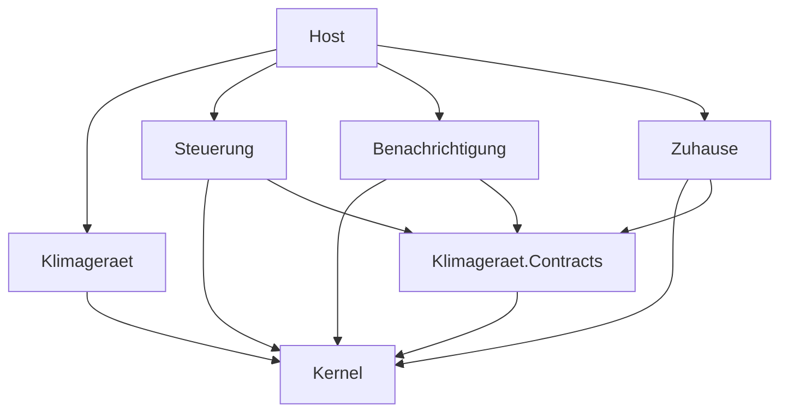
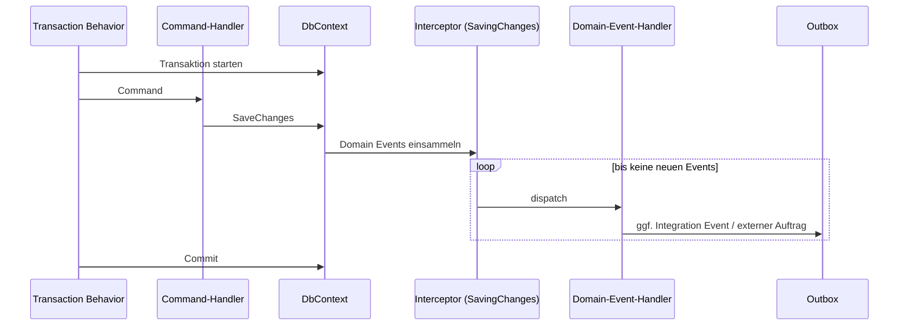
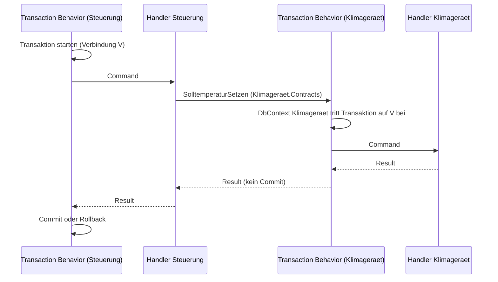
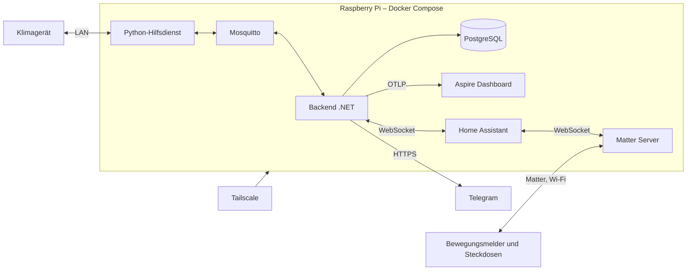

# Architecture Spine – smart-home Backend

## Design Paradigm

**Modularer Monolith**: ein Prozess, mehrere fachliche Module mit harten Grenzen. Innerhalb eines Moduls **Vertical Slice Architecture**: ein Ordner pro Feature (Command oder Query), darunter ein gemeinsames **DDD-Domänenmodell** (Aggregates, Domain Events). **CQRS** über einen eigenen Mediator.

| Ebene | Ort | Inhalt |
| --- | --- | --- |
| Host | `Host` | Komposition, Minimal-API-Mapping, OTEL, globaler Exception Handler |
| Kernel | `Kernel` | Mediator, Pipeline Behaviors, Result, Outbox, Domain-Event-Interceptor |
| Modul | `Modules/<Modul>` | `Domain/`, `Features/<Feature>/`, `Infrastructure/` |
| Modul-Vertrag | `Modules/<Modul>.Contracts` | Integration Events und Commands für synchrone Aufrufe |

## Invariants & Rules



### AD-1 — Module nach Fachlichkeit [ADOPTED]

- **Binds:** alle Slices
- **Prevents:** technische Module (z. B. „Umsysteme“) und Prozesslogik im falschen Modul
- **Rule:** Es gibt vier Module: **Klimageraet** (P1 Fähigkeiten, P2 Messung, P3 Offline-Erkennung, Befehle ans Klimagerät), **Steuerung** (P5 manuell steuern), **Zuhause** (P9–P14: Anwesenheit, Home-Assistant-Anbindung für Bewegungsmelder und Steckdosen, Nachhause-Kommen, Einrichten, Ausschalten) und **Benachrichtigung** (Telegram für P3/P4). P6–P8 sind entfallen. Jeder Slice gehört genau einem Modul. Ein Modul wird erst angelegt, wenn sein erster Prozess umgesetzt wird.

### AD-2 — Abhängigkeiten zwischen Modulen [ADOPTED]

- **Binds:** alle Projekte
- **Prevents:** Zugriff auf Interna fremder Module
- **Rule:** Ein Modul referenziert nur `Kernel` und die `<Modul>.Contracts`-Projekte anderer Module, nie deren Hauptprojekt. `<Modul>.Contracts` enthält nur Integration Events und Commands für synchrone Aufrufe und referenziert nur `Kernel`. Nur `Host` kennt alle Module.

### AD-3 — Datenhoheit pro Modul [ADOPTED]

- **Binds:** Persistenz aller Module
- **Prevents:** Lese- und Schreibzugriffe auf fremde Tabellen
- **Rule:** Jedes Modul hat einen eigenen DbContext, ein eigenes PostgreSQL-Schema und eigene EF-Core-Migrationen. Alle Schemas liegen in derselben Datenbank. Ein Modul liest und schreibt nur sein eigenes Schema. Daten anderer Module erhält es ausschliesslich über Integration Events oder synchrone Commands aus deren Contracts.

### AD-4 — Vertical Slices und CQRS [ADOPTED]

- **Binds:** alle Features
- **Prevents:** geteilte Service-Schichten und Commands, die am Aggregate vorbei schreiben
- **Rule:** Jedes Feature liegt in einem Ordner `Features/<Feature>/` mit Endpoint, Command bzw. Query, Handler und – bei Commands – Validator. Commands ändern Zustand nur über ein Aggregate. Queries lesen direkt per Projektion (ohne Tracking, ohne Aggregate) und laufen ohne Transaction Behavior.

### AD-5 — Eigener Mediator und Pipeline [ADOPTED]

- **Binds:** alle Commands und Queries
- **Prevents:** Lizenzabhängigkeit und abweichende Pipeline-Reihenfolgen
- **Rule:** Der Mediator ist selbst gebaut (`Kernel`). Die Pipeline für Commands lautet: **Validation → Transaction → Handler**. Validatoren sind FluentValidation-Validatoren im Feature-Ordner. Schlägt die Validation fehl, wird keine Transaktion gestartet; sie liefert einen `ValidationError`. Das Transaction Behavior löst anhand des Commands den DbContext des zuständigen Moduls auf und startet eine Transaktion oder übernimmt die bestehende (AD-14).

### AD-6 — Ablauf eines Commands und Domain Events [ADOPTED]

- **Binds:** alle Command-Handler und Domain-Event-Handler
- **Prevents:** Events nach dem Commit, zweites `SaveChanges` aus Handlern, Kaskaden
- **Rule:** Transaktion starten → Handler → `SaveChanges` → Interceptor im **SavingChanges**-Hook dispatcht Domain Events in-process (in einer Schleife, bis keine neuen entstehen) → Commit. Domain-Event-Handler arbeiten nur im eigenen Modul und im selben DbContext, rufen nie `SaveChanges` auf, rufen nie Umsysteme auf und rufen nie fremde Module auf. Gespeichert wird nur asynchron (`SaveChangesAsync`); der Interceptor implementiert `SavingChangesAsync`.



### AD-7 — Synchron nur bei gleicher Konsistenz [ADOPTED]

- **Binds:** alle Reaktionen auf Events
- **Prevents:** Rollback einer Messung durch Fehler in einer nachgelagerten Policy
- **Rule:** Synchron als Domain-Event-Handler läuft nur, was zusammen mit dem auslösenden Command konsistent sein muss. Prozess-Policies anderer Module reagieren auf Integration Events über die Outbox.

### AD-8 — Outbox für Integration Events und Umsysteme [ADOPTED]

- **Binds:** alle Integration Events und alle Aufrufe an Telegram, MQTT und Home Assistant
- **Prevents:** Nachrichten oder Befehle, die trotz Rollback hinausgehen; lange offene Transaktionen
- **Rule:** Integration Events und Aufträge an Umsysteme werden in der Transaktion in die Outbox-Tabelle des eigenen Modul-Schemas geschrieben. Ein Background Worker stellt sie nach dem Commit zu – Integration Events über den Mediator an die Handler anderer Module und an eigene Konsumenten des Moduls (AD-19), die in einer eigenen Transaktion laufen. Die Zustellung ist **at-least-once**, FIFO pro Ziel (Konsument bzw. Umsystem) und sequenziell; ein Ausfall eines Ziels, z. B. Home Assistant, blockiert die Zustellung an andere Ziele nicht. Jedes Modul mit Konsumenten hat eine Inbox-Tabelle in seinem Schema: Der Konsument schreibt (`EventId`, Konsument) in derselben Transaktion wie seinen Command; ist der Eintrag schon vorhanden, wird das Event übersprungen. Aufrufe an Umsysteme (Telegram, Home Assistant) bleiben at-least-once; eine doppelte Nachricht wird in Kauf genommen, ein doppelter Schaltbefehl ändert nichts (Zielzustand, AD-9). Jedes Integration Event trägt eine `EventId` (GUID v7) und den fachlichen Zeitpunkt, auf den sich Konsumenten stützen – nie auf den Zeitpunkt der Verarbeitung. Ein Konsument übersetzt ein Integration Event in genau einen Command des eigenen Moduls. Der Worker stellt pro Konsument in einem eigenen DI-Scope ohne laufende Transaktion zu.

### AD-9 — Gerätezugriff: MQTT nur in Klimageraet, Home Assistant nur in Zuhause [ADOPTED]

- **Binds:** MQTT- und Home-Assistant-Anbindung
- **Prevents:** mehrere Module mit eigenem MQTT- oder Home-Assistant-Zugriff
- **Rule:** Nur das Modul Klimageraet spricht MQTT; nur das Modul Zuhause spricht Home Assistant (AD-18). Eingehende Messungen werden zum Command `MessungAufnehmen`. Andere Module senden Befehle ans Klimagerät als Command aus `Klimageraet.Contracts`; Klimageraet schreibt sie in seine Outbox und sendet sie per MQTT. Befehle beschreiben immer einen Zielzustand (z. B. „Solltemperatur 22 °C“), nie ein Umschalten, damit eine doppelte Zustellung nichts ändert. Der Zustand des Aggregates Klimageraet ändert sich nur durch `MessungAufnehmen`; ein Befehl erzeugt nur einen Outbox-Auftrag. Schreibende Endpoints für das Klimagerät (z. B. P5) liegen nur im Modul Steuerung.

### AD-10 — Fehlerbehandlung [ADOPTED]

- **Binds:** alle Handler und Endpoints
- **Prevents:** vergessene Fehlertypen und eigene Fehlercodes pro Slice
- **Rule:** Erwartete Fehler sind ein eigener `Result`-Typ (`Kernel`), dessen Fehlerfälle eine C# 15 Union sind: `ValidationError` (inkl. verletzter Fachregeln) und `NotFoundError`. Eine zentrale Extension Method bildet sie mit einer **exhaustiven switch expression** (ohne Discard) auf `ProblemDetails` ab: `ValidationError` → 400, `NotFoundError` → 404. Die Warnungen CS8509 und CS8655 sind Fehler (`WarningsAsErrors`), und jede switch expression über eine Union hat einen expliziten `null`-Arm. Alles Unerwartete, auch transiente Fehler, ist eine Exception und landet beim globalen Exception Handler (500). Exceptions aus `mediator.Send` werden in Handlern nie abgefangen.

### AD-11 — Zeit [ADOPTED]

- **Binds:** alle Zeit-Trigger, Zeitvergleiche und gespeicherten Zeitpunkte
- **Prevents:** `DateTime.Now`, nicht testbare Zeit-Trigger, Zeitzonenfehler
- **Rule:** Zeit kommt nur aus `TimeProvider`. Zeitpunkte sind `DateTimeOffset` in UTC (Offset 0) und werden als `timestamptz` gespeichert. Fachliche Zeiten werden in Europe/Zurich ausgewertet; Fristen (Offline und Abwesend je 2 Minuten) rechnen auf UTC-Zeitpunkten.

### AD-12 — IDs im Code [ADOPTED]

- **Binds:** alle Entitäten
- **Prevents:** fehlende IDs beim Dispatch in SavingChanges
- **Rule:** IDs werden im Code erzeugt, nie von der Datenbank: `Guid.CreateVersion7(timeProvider.GetUtcNow())`.

### AD-13 — Zugriff ohne Anmeldung [ADOPTED]

- **Binds:** HTTP-Schnittstelle
- **Prevents:** halbe Autorisierungslogik in einzelnen Slices
- **Rule:** Die App hat keine Anmeldung. Erreichbar ist sie nur im LAN und von aussen über Tailscale.

### AD-14 — Synchrone Aufrufe zwischen Modulen in einer Transaktion [ADOPTED]

- **Binds:** alle Commands aus `<Modul>.Contracts`, das Transaction Behavior, alle Modul-DbContexts
- **Prevents:** halb ausgeführte modulübergreifende Commands; parallele, voneinander unabhängige Transaktionen pro DbContext
- **Rule:** Ein Command aus einem fremden `<Modul>.Contracts` darf aus einem Endpoint, einem Command-Handler, einem Outbox-Konsumenten oder einem Zeit-Trigger aufgerufen werden – nicht aus einem Domain-Event-Handler (AD-6). Er läuft über den Mediator durch die volle Pipeline. Das Transaction Behavior löst den DbContext des Moduls auf, dem der Command gehört; läuft bereits eine Transaktion, tritt dieser DbContext ihr über dieselbe Datenbankverbindung bei, sonst startet es eine neue. Alle Modul-DbContexts eines Scopes teilen deshalb eine Verbindung: eine scoped `NpgsqlConnection`, die jedem DbContext per `UseNpgsql(DbConnection)` übergeben wird; beigetreten wird per `UseTransactionAsync`. Eine Retrying Execution Strategy wird nicht verwendet. Nur das äusserste Transaction Behavior committet (bei Erfolg) oder rollt zurück (bei Fehler-Result oder Exception); ein beigetretenes committet nie selbst. Ein beigetretenes Behavior setzt vor dem Handler einen Savepoint und rollt bei Fehler-Result oder Exception darauf zurück. Contract-Commands sind azyklisch: heute Steuerung → Klimageraet und Zuhause → Klimageraet; Klimageraet meldet sich bei Steuerung und Zuhause nur über Integration Events. Das Transaction Behavior verweigert den erneuten Eintritt in einen DbContext, der im Scope bereits einen Command ausführt.



### AD-15 — Einstiegspunkte

- **Binds:** HTTP-Endpoints, MQTT-Eingang, Home-Assistant-Ereignisse, Zeit-Trigger (z. B. Prüfung der IP-Präsenz), Outbox-Konsumenten
- **Prevents:** Fachlogik ausserhalb von Handlern; Einstiege, die den DI-Scope oder eine fremde Transaktion teilen
- **Rule:** Jeder Einstiegspunkt erzeugt einen eigenen DI-Scope und sendet genau einen Command bzw. eine Query über den Mediator; er enthält keine Fachlogik. Die Eingangsschnittstelle „Messung empfangen“ (Spec P2) ist eine Schnittstelle im Modul Klimageraet; der MQTT-Adapter implementiert sie.

### AD-16 — Nebenläufigkeit

- **Binds:** alle Aggregates
- **Prevents:** verlorene Updates bei parallelen Commands auf dasselbe Aggregate
- **Rule:** Jedes Aggregate hat ein Concurrency Token (PostgreSQL `xmin`). Ein Konflikt ist eine Exception (AD-10); Outbox-Konsumenten werden vom Worker erneut zugestellt. Einstiegspunkte von Zuhause (IP-Prüfung, Home-Assistant-Ereignisse) wiederholen ihren Command bei einem Konflikt, höchstens dreimal, und verarbeiten Ereignisse pro Aggregate sequenziell; sonst ginge z. B. die erste Bewegung nach der Abwesenheit verloren.

### AD-17 — Veröffentlichte Events des Moduls Klimageraet

- **Binds:** P2 und alle Konsumenten in Zuhause und Benachrichtigung; Spec P2
- **Prevents:** fremde Module, die an Domain Events hängen; uneinheitliche Event-Formen
- **Rule:** Klimageraet veröffentlicht die abgeleiteten Events `SolltemperaturGeaendert`, `ModusGeaendert`, `Eingeschaltet`, `Ausgeschaltet`, `SelbstreinigungGestartet` und `FehlercodeGemeldet` 1:1 als Integration Events in `Klimageraet.Contracts` über die Outbox. `MessungAufgenommen` bleibt modulintern. Zusätzlich veröffentlicht es [ASSUMPTION: pro Messung, vom Bewohner nicht bestätigt] mit jeder Messung `MesswerteGemeldet` (Raumtemperatur, Aussentemperatur, fachlicher Zeitpunkt); Zuhause hält daraus den letzten Wert für die Warm-Prüfung (CAP-14).

### AD-18 — Home Assistant als Gateway für Matter-Geräte [ADR 0004, vorgeschlagen]

- **Binds:** alle Slices in Zuhause, die Bewegungsmelder oder Steckdosen lesen oder schalten
- **Prevents:** Fachlogik in Home-Assistant-Automationen, Matter- oder Home-Assistant-Zugriff in mehreren Modulen, Entity-IDs im Code
- **Rule:** Nur das Modul Zuhause spricht Home Assistant über die WebSocket-API; Home Assistant bindet Matter über einen Matter Server ein, der bei einer Container-Installation ein eigener Container im Compose ist (Host-Netzwerk, WebSocket-Port 5580). Eingehende Zustandsänderungen (Bewegung am Eingang, Leistung der Steckdosen) werden zu Commands von Zuhause (`BewegungAufnehmen`, `LeistungAufnehmen`). Schaltbefehle an Steckdosen sind Outbox-Aufträge mit Zielzustand (AD-8, AD-9). Home-Assistant-Automationen enthalten keine Fachlogik. Geräte und Entity-IDs sind Konfiguration (Options-Pattern), das Token ein Secret aus der Umgebung; der Adapter liegt hinter einer Schnittstelle, Tests setzen einen Fake ein. Verbindungsvertrag: Home Assistant liefert Events nur im Prozess an die laufende Verbindung (ein Listener pro Abo, begrenzte Ausgangs-Queue; läuft sie voll, trennt Home Assistant), ohne Replay, also höchstens einmal. Der Adapter abonniert schmal (`subscribe_trigger` oder `subscribe_entities` für die konfigurierten Entitäten statt aller `state_changed`), baut nach jedem Verbindungsaufbau Auth und Abos neu auf (Reconnect mit Backoff) und liest danach den Zustand per `get_states` neu ein, bevor er Commands sendet. Das Token-Konto braucht Admin-Rechte, wenn der Adapter `subscribe_events` nutzt.

### AD-19 — Anwesenheit und Reaktionen im Modul Zuhause

- **Binds:** P9–P14
- **Prevents:** Einrichten oder Ausschalten als Domain-Event-Handler mit Aufrufen an fremde Module; mehrere Wahrheiten über die Anwesenheit
- **Rule:** Das Aggregate `Anwesenheit` hat die Zustände `Anwesend`, `Abwesend` und `Zurueck` (IP wieder da, Bewegung steht aus) und wird beim ersten Command angelegt. Es ändert sich nur durch die Commands `IpPraesenzAufnehmen`, `BewegungAufnehmen` und `LeistungAufnehmen`. Die 2-Minuten-Frist rechnet allein das Aggregate: Der IP-Trigger sendet bei jeder Prüfung (erreichbar ja oder nein, Zeitpunkt der Prüfung), nie nur Flanken; Bewegung und Leistung tragen ihren fachlichen Zeitpunkt. Daraus entstehen die Domain Events `NachhauseGekommen` und `AbwesendGeworden`; ihr Handler schreibt je ein Integration Event in die Outbox von Zuhause. `Einrichten` und `Ausschalten` laufen als Outbox-Konsumenten dieser Events (eigener Scope, eigene Transaktion), schalten Steckdosen über die Outbox (AD-18) und senden das Klimagerät über Commands aus `Klimageraet.Contracts` (AD-14), nie aus einem Domain-Event-Handler (AD-6). Jeder Geräteschritt von `Einrichten` und `Ausschalten` (Schreibtisch, Licht, Klima) ist ein eigener Auftrag bzw. Command; ein Fehler-Result eines Schritts verhindert die übrigen nicht und führt nicht zu endloser Neuzustellung. Die letzte Raum- und Aussentemperatur hält das eigene Aggregate `Raumwerte`, nicht `Anwesenheit`; ein Konsument von `MesswerteGemeldet` schreibt es. Die Events sind modulintern; `Zuhause.Contracts` entsteht erst, wenn ein anderes Modul sie braucht.

## Consistency Conventions

| Concern | Convention |
| --- | --- |
| Naming | ADR 0003: Fachbegriffe deutsch wie CONTEXT.md, Umlaute als ae/oe/ue; Technisches englisch. Commands im Infinitiv (`MessungAufnehmen`), Events im Partizip (`MessungAufgenommen`). |
| Schemas und Tabellen | Schema = Modulname klein (`klimageraet`); Tabellen klein, Plural, snake_case |
| Fehlerform HTTP | `ProblemDetails` (RFC 9457) |
| Zeitstempel | `DateTimeOffset` in UTC im Code, `timestamptz` in PostgreSQL |
| Observability | OpenTelemetry für Traces, Metriken und Logs per OTLP an das Aspire Dashboard. Jeder Command und jede Query ist ein Span; die Outbox speichert den Trace-Kontext und setzt ihn bei der Zustellung fort. |
| Konfiguration | Options-Pattern pro Modul, Werte aus Umgebungsvariablen (Docker Compose), auch Home-Assistant-URL und Token |
| Tests | Ein Seam an der Backend-Grenze: `WebApplicationFactory` mit PostgreSQL via Testcontainers; Umsysteme (MQTT, Telegram, Home Assistant) als Fakes hinter ihrer Schnittstelle |

## Stack

| Name | Version |
| --- | --- |
| .NET / ASP.NET Core | 11.0 (GA 2026-11-10, STS bis 2028-11) |
| C# | 15 |
| EF Core | 11.0 |
| Npgsql.EntityFrameworkCore.PostgreSQL | 11.0.0-rc.3 (GA ausstehend – Risiko) |
| FluentValidation | 12.2 |
| PostgreSQL | 18 |
| Eclipse Mosquitto | 2.1 |
| Home Assistant (Container, beim Bewohner vorhanden) | Version des Bewohners; WebSocket-API |
| Aspire Dashboard (`mcr.microsoft.com/aspire/dashboard`) | 13.6 |
| OpenTelemetry .NET | 1.21 |
| Testcontainers für .NET | 4.16 |
| Docker Compose | v2 |

## Structural Seed

```text
Backend/
  src/
    Host/                         # Program, Komposition, Endpoint-Mapping, OTEL, Exception Handler
    Kernel/                       # Mediator, Behaviors, Result, Outbox, Interceptor
    Modules/
      Klimageraet/                # Domain/, Features/<Feature>/, Infrastructure/ (DbContext, MQTT)
      Klimageraet.Contracts/      # Integration Events, Commands für synchrone Aufrufe
      Zuhause/                    # Domain/, Features/<Feature>/, Infrastructure/ (DbContext, Home-Assistant-Adapter); entsteht mit P9
  tests/
    Backend.Tests/                # Seam-Tests an der Backend-Grenze
```



## Capability → Architecture Map

| Capability / Area | Lives in | Governed by |
| --- | --- | --- |
| P1 Fähigkeiten erfragen | Klimageraet | AD-1, AD-9 |
| P2 Zustand und Messwerte erfassen | Klimageraet | AD-1, AD-6, AD-8, AD-9, AD-15, AD-17, Spec P2 |
| P3 Erreichbarkeit überwachen | Klimageraet (Erkennung), Benachrichtigung (Telegram) | AD-1, AD-8, AD-11 |
| P4 Störung melden | Benachrichtigung | AD-7, AD-8 |
| P5 Manuell steuern | Steuerung → Klimageraet | AD-9, AD-14 |
| P9 Anwesenheit überwachen | Zuhause | AD-11, AD-15, AD-18, AD-19 |
| P10 Matter-Geräte ansteuern | Zuhause | AD-8, AD-9, AD-18 |
| P11 Nachhause-Kommen erkennen | Zuhause | AD-6, AD-19 |
| P12 Dunkelheit bestimmen | Zuhause | AD-11, AD-15 |
| P13 Wohnung einrichten | Zuhause → Klimageraet | AD-8, AD-14, AD-17, AD-19 |
| P14 Wohnung ausschalten | Zuhause → Klimageraet | AD-8, AD-14, AD-19 |

## Deferred

- **Retry-, Backoff- und Aufräumregeln der Outbox**: liegen zentral im Worker im `Kernel`; Festlegung mit dem ersten Worker.
- **MQTT-Vertrag mit dem Hilfsdienst** (Topics, Payload, QoS, Zeitformat, `schemaVersion`): eigenes ADR vor dem Slice MQTT-Adapter.
- **Quelle der Sonnenzeiten** (Meteomatics oder `sun` aus Home Assistant) : mit P12 entscheiden. Die IP-Präsenz prüft das Backend selbst (Zeit-Trigger, AD-15); **Verfahren** (Ping oder ARP) und **Netzwerk-Rechte im Container**: mit P9.
- **Home-Assistant-Vertrag** (Authentifizierung, Reconnect, Event-Form, Verhalten bei Ausfall), **Commissioning der Matter-Geräte**, **Compose-Besitz und Host-Netzwerk** für Home Assistant und den Matter Server sowie **Ressourcen auf dem Pi 5**: eigenes Slice vor P9, denn P9 braucht über die 50-W-Regel schon die Leistung aus Home Assistant.
- **Zeitpunkt der EF-Core-Migrationen** (beim Start oder separat), **Architektur-Tests** für AD-2/AD-6 und **Secrets/Absicherung von Mosquitto**: mit dem ersten Slice bzw. vor dem produktiven Betrieb.
- **Versionierung von Integration Events und Contract-Commands**: erst nötig, wenn ein Vertrag geändert wird.
- **Dauerhafte Telemetrie**: Aspire Dashboard 13.6 bietet optionale Persistenz; ein Grafana-Stack erst, wenn das nicht mehr reicht.
- **Backup von PostgreSQL** (z. B. `pg_dump`) und **CI-Pipeline**: eigene Slices vor dem produktiven Betrieb.
- **Zuordnung Command → Modul-DbContext** (z. B. über Assembly-Registrierung pro Modul): Mechanismus liegt zentral im `Kernel`, darum keine Divergenz; Festlegung mit dem ersten Modul.
- **Auslagern eines Moduls in eine eigene Datenbank**: würde AD-14 brechen; erst neu zu entscheiden, wenn es nötig wird.
- **UI**: nicht Teil des Backends.
